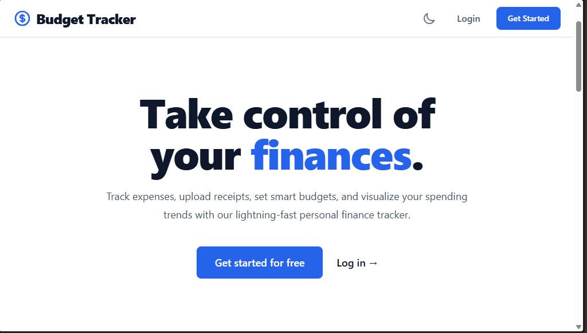
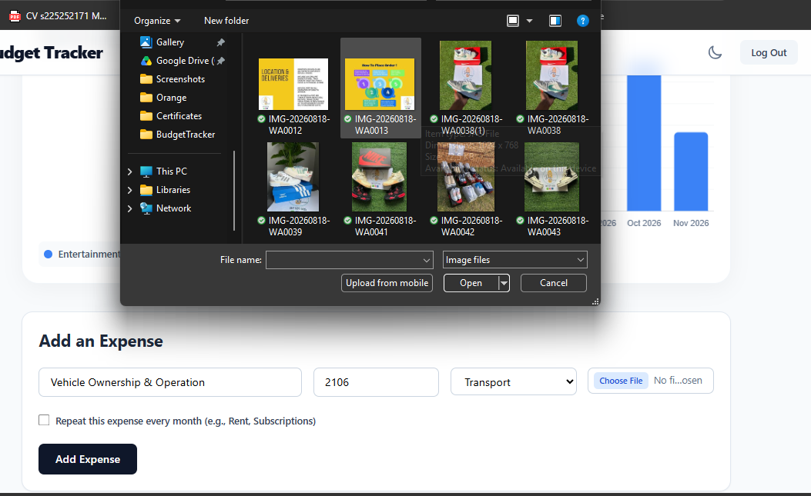

# Budget Tracker

A full-stack personal finance application for tracking income and expenses.

## Tech Stack

- **Backend:** C# / ASP.NET Core Web API (.NET 9)
- **ORM:** Entity Framework Core 9
- **Database:** PostgreSQL (hosted on Supabase)
- **Auth:** ASP.NET Core Identity + JWT
- **Frontend:** Angular 19 (standalone components, TypeScript)
- **Charts:** Chart.js

## Project Structure
# 💰 Budget Tracker

A full-stack personal finance application designed to help users track expenses, manage budgets, and visualize their spending habits. 

Built with a decoupled architecture using **C# ASP.NET Core** for the backend, **Angular** for the frontend, and **PostgreSQL (Supabase)** for the database.

## 🚀 Live Demo
- **Frontend:** *[Coming Soon - Deploying to Vercel]*
- **Backend API:** *[Coming Soon - Deploying to Render]*

## 📸 Screenshots

| Landing Page | Dashboard (Light Mode) |
| :---: | :---: |
|  |  |

| Dashboard (Dark Mode) | Add Expense & Upload |
| :---: | :---: |
|  |  |

*(Optional: Add a screenshot of the Pending Recurring banner here)*

## ✨ Key Features

- ** Secure Authentication:** Full user registration, login, and password reset flows using ASP.NET Core Identity and JWT (JSON Web Tokens).
- ** Visual Analytics:** Interactive Doughnut charts and 6-month Bar charts using Chart.js to visualize spending by category and monthly trends.
- ** Expense Management:** Full CRUD operations (Create, Read, Update, Delete) for expenses and budgets.
- ** Monthly Budgets:** Set spending limits for specific categories. Features dynamic progress bars that turn red when the budget is exceeded.
- **📎 Receipt Upload:** Upload physical receipts directly to Supabase Storage and attach them to specific expenses.
- ** Recurring Transactions:** Automatically generate pending recurring expenses (like Rent or Netflix). Users must "Approve" them before they affect their budget.
- ** Advanced Filtering:** Real-time search by description and filter by category.
- ** Smart Insights:** Generates personalized insights (e.g., "Your highest spending category is Rent").
- ** Dark Mode:** Fully responsive and accessible Dark Mode toggle across the entire application.

## 🛠️ Tech Stack

**Backend:**
- C# / ASP.NET Core Web API (.NET 9)
- Entity Framework Core 9
- ASP.NET Core Identity + JWT Bearer Authentication
- Swagger / OpenAPI

**Frontend:**
- Angular 19 (Standalone Components, TypeScript)
- Tailwind CSS (Styling & Dark Mode)
- Chart.js (Data Visualization)
- Supabase JS Client (File Storage)

**Database & Infrastructure:**
- PostgreSQL (Hosted on Supabase)
- Supabase Storage (Receipts)

## 🏗️ Architecture

The application uses a decoupled architecture:
1. The **Angular Frontend** sends HTTP requests containing the JWT token.
2. The **C# API** validates the token, ensures the user has access to the requested data, and processes the business logic.
3. **Entity Framework Core** translates C# objects into SQL queries and saves them to the **Supabase PostgreSQL database**.
4. Receipts are uploaded directly from Angular to **Supabase Storage**, and the resulting URL is saved in the database.

## 📂 Project Structure

```text
budget-tracker/
├── BudgetTrackerAPI/           # C# ASP.NET Core Web API (Backend)
│   ├── Data/                   # Entity Framework Context & Factories
│   ├── Models/                 # Database Entities (Expense, Budget, AppUser)
│   ├── Migrations/             # EF Core Database Migrations
│   └── Program.cs              # API Endpoints & Middleware configuration
├── budget-tracker-frontend/    # Angular Frontend
│   ├── src/app/
│   │   ├── components/         # UI Components (Login, Register, Dashboard)
│   │   ├── guards/             # Route Guards (Auth, Guest)
│   │   ├── interceptors/       # HTTP Interceptor (Attaches JWT)
│   │   └── services/           # Angular Services (API calls)
│   └── tailwind.config.js      # Tailwind Configuration
└── README.md